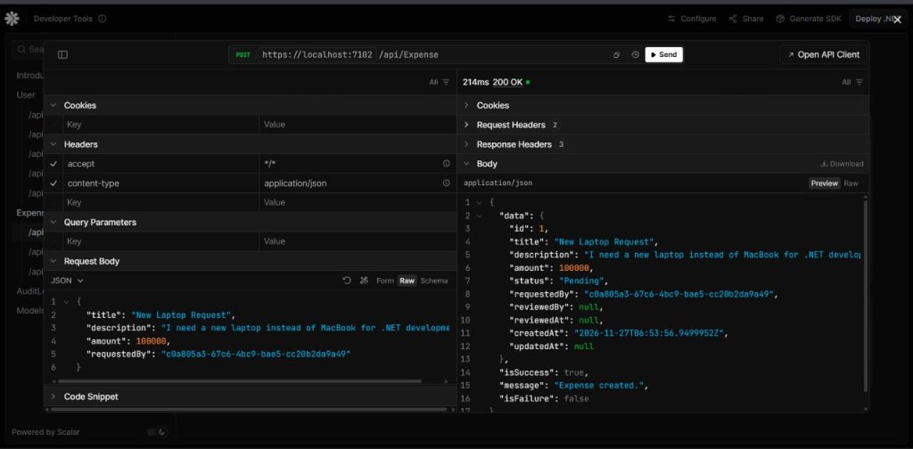
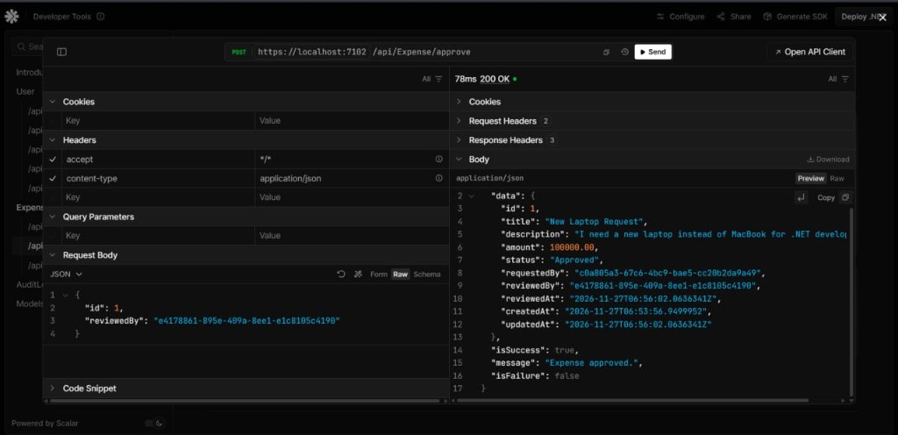
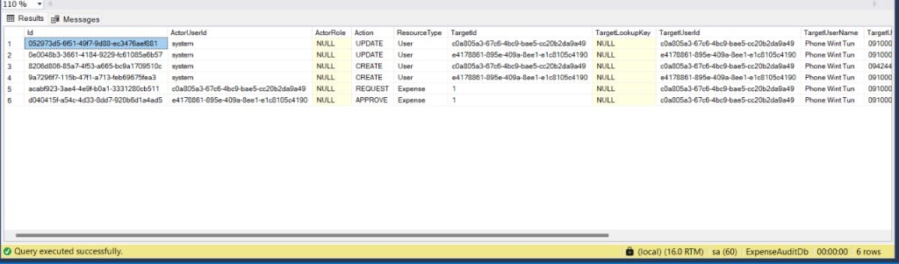

# Expense Approval System

An ASP.NET Core (.NET 10) Web API for managing users, expense requests, approval/rejection workflows, and event-driven audit logging backed by SQL Server, Entity Framework Core, MediatR, and Scalar OpenAPI.

---

## Features

- **User Management**: Create, list, retrieve, partially update (`PATCH`), and delete users with configurable spending/approval limits.
- **Expense Workflow**: Submit expense requests (`Pending`), approve, or reject expenses with policy-based validation.
- **Business Rules & Validation**:
  - Expense amounts must be between `0` and `1,000,000`.
  - Only `Pending` expenses can be approved or rejected.
  - Requesters cannot approve or reject their own expenses.
  - Expense amounts cannot exceed the reviewer's or requester's configured `Limit`.
  - Rejection requires a non-empty `Reason`.
- **Event-Driven Audit Logging**: Domain actions (`CREATE`, `UPDATE`, `DELETE`, `REQUEST`, `APPROVE`, `REJECT`) publish `AuditEvent` notifications via **MediatR**, which are persisted to `TblAuditLog` with field-level change tracking and target user resolution.
- **Consistent API Responses**: All endpoints return a standardized `Result` / `Result<T>` envelope (`isSuccess`, `isFailure`, `message`, `data`).
- **Interactive API Docs**: Built-in OpenAPI specification with **Scalar** UI in Development mode.

---

## Tech Stack

| Layer | Technology |
| --- | --- |
| Framework | .NET 10 / ASP.NET Core Web API |
| Database | SQL Server (`ExpenseAuditDb`) |
| ORM | Entity Framework Core 10 (`Microsoft.EntityFrameworkCore.SqlServer`) |
| Messaging / Events | MediatR 15 |
| API Documentation | `Microsoft.AspNetCore.OpenApi` + `Scalar.AspNetCore` |

---

## Solution Structure

```text
ExpenseApprovalSystem/
├── ExpenseApprovalSystem.slnx
├── ExpenseApprovalSystem.Api/          # ASP.NET Core Web API, Controllers, OpenAPI/Scalar
│   ├── Controllers/Features/
│   │   ├── AuditLog/AuditLogController.cs
│   │   ├── Expense/ExpenseController.cs
│   │   └── Users/UserController.cs
│   └── Program.cs
├── ExpenseApprovalSystem.Domain/       # Feature slices, services, policies, MediatR audit handler
│   ├── FeatureManager.cs               # DI registration (builder.AddDomain())
│   └── Features/
│       ├── AuditLog/                   # AuditEvent, AuditEventHandler, AuditLogService, AuditTargetResolver
│       ├── Expense/                    # ExpenseService, ExpenseValidationPolicy, ExpenseModels
│       └── Users/                      # UserService, UserValidationPolicy, UserModels
├── ExpenseApprovalSystem.Database/     # EF Core DbContext and entity models
│   └── AppDbContextModels/
│       ├── AppDbContext.cs
│       ├── TblAuditLog.cs
│       ├── TblExpense.cs
│       └── TblUser.cs
└── ExpenseApprovalSystem.Shared/       # Shared Result / Result<T> wrapper
    └── Result.cs
```

---

## Getting Started

### Prerequisites

- [.NET 10 SDK](https://dotnet.microsoft.com/download)
- SQL Server (LocalDB, SQL Server Express, or Docker)

### 1. Configure the Database Connection

Update `ConnectionStrings:DefaultConnection` in `ExpenseApprovalSystem.Api/appsettings.json` (or `appsettings.Development.json`) to point to your SQL Server instance:

```json
{
  "ConnectionStrings": {
    "DefaultConnection": "Server=.;Database=ExpenseAuditDb;User ID=sa;Password=your_password;TrustServerCertificate=True;"
  }
}
```

### 2. Database Schema

Create the `ExpenseAuditDb` database with the three tables mapped in `AppDbContext`:

- `TblUser` (`Id`, `Name`, `Email`, `MobileNo`, `Limit`, `Status`, `CreatedAt`)
- `TblExpense` (`Id`, `Title`, `Description`, `Amount`, `Status`, `RequestedBy`, `ReviewedBy`, `ReviewedAt`, `CreatedAt`, `UpdatedAt`)
- `TblAuditLog` (`Id`, `ActorUserId`, `ActorRole`, `Action`, `ResourceType`, `TargetId`, `TargetLookupKey`, `TargetUserId`, `TargetUserName`, `TargetUserMobileNo`, `Changes`, `Reason`, `ActionDateTime`)

### 3. Run the API

```bash
dotnet restore
dotnet run --project ExpenseApprovalSystem.Api
```

By default, the API runs on:
- **HTTPS**: `https://localhost:7102`
- **HTTP**: `http://localhost:5177`

In Development mode, open the **Scalar API Reference** at:
- `https://localhost:7102/scalar/v1`

---

## API Endpoints

### Users (`/api/User`)

| Method | Endpoint | Description |
| --- | --- | --- |
| `GET` | `/api/User` | Get all users |
| `GET` | `/api/User/{id}` | Get a user by ID |
| `POST` | `/api/User` | Create a new user |
| `PATCH` | `/api/User/{id}` | Partially update a user |
| `DELETE` | `/api/User/{id}` | Delete a user |

### Expenses (`/api/Expense`)

| Method | Endpoint | Description |
| --- | --- | --- |
| `POST` | `/api/Expense` | Submit a new expense request |
| `POST` | `/api/Expense/approve` | Approve a pending expense |
| `POST` | `/api/Expense/reject` | Reject a pending expense (requires `reason`) |

### Audit Logs (`/api/AuditLog`)

| Method | Endpoint | Description |
| --- | --- | --- |
| `GET` | `/api/AuditLog` | Retrieve all audit log entries |

---

## Screenshots

### 1. Create Expense Request (`POST /api/Expense`)

Submitting a new expense request via Scalar returns the created expense with `status: "Pending"`:



### 2. Approve Expense Request (`POST /api/Expense/approve`)

Approving the pending expense with a reviewer ID updates the status to `"Approved"` and records `reviewedBy` and `reviewedAt`:



### 3. Audit Log Trail (`TblAuditLog`)

All user and expense actions (`CREATE`, `UPDATE`, `REQUEST`, `APPROVE`) are automatically recorded in `TblAuditLog` with actor and target user metadata:


